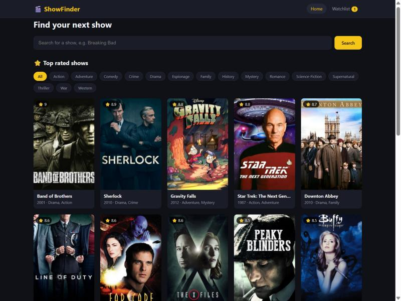
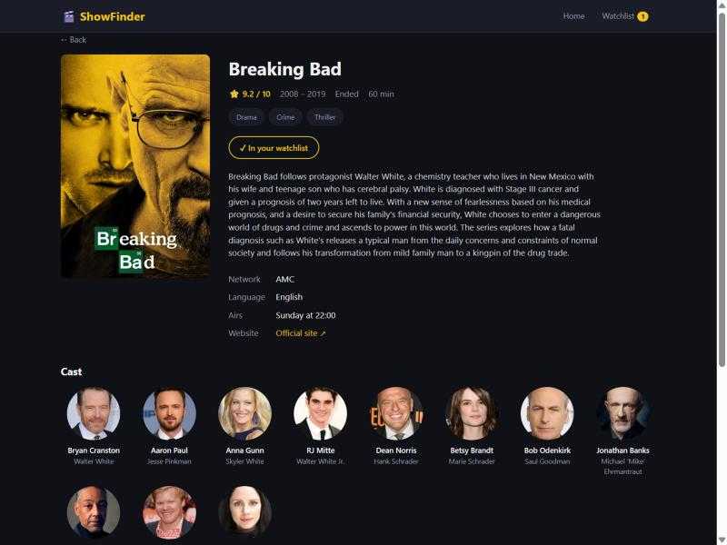

# 🎬 ShowFinder: Movie & TV Show Search

A React app to search TV shows, see details like cast and episodes, and keep a personal watchlist.
It uses the free [TVmaze API](https://www.tvmaze.com/api), so no API key is needed.

This is **Day 4** of my daily project challenge, where I build one project every day, from simple to advanced.

🔗 **Live demo:** https://gopichandreddy007.github.io/movie-search-app/





## Features

- **Top rated shows** on the home page
- **Search** any show by name. The search text is kept in the URL, so refresh, sharing a link and the back button all work
- **Genre filter** for the results (also saved in the URL)
- **Show details page** with poster, rating, years, network, schedule and summary
- **Cast** with photos and character names
- **Episodes** grouped by season with season tabs
- **Watchlist**: add or remove shows, saved in localStorage, with a count in the navbar and a ❤️ on saved cards
- **404 page** for unknown pages and show IDs that don't exist
- Loading spinner and friendly error messages
- Responsive design for mobile, tablet and desktop
- Deployed automatically to GitHub Pages with GitHub Actions

## Tech Stack

- [React](https://react.dev/) with hooks
- [React Router](https://reactrouter.com/): pages, URL params and search params
- React Context: shared watchlist state
- Custom hook `useFetch`: loading, error and data for API calls
- [Vite](https://vite.dev/)
- [TVmaze API](https://www.tvmaze.com/api)
- CSS (Grid, Flexbox, media queries, CSS variables)

## Pages

| Route        | Page                                  |
| ------------ | ------------------------------------- |
| `/`          | Top rated shows + search + genre filter |
| `/show/:id`  | Show details, cast and episodes       |
| `/watchlist` | Saved shows                           |
| `*`          | 404 page                              |

## Project Structure

```
src/
├── api/
│   └── tvmaze.js              # all API calls in one place
├── components/
│   ├── Navbar.jsx
│   ├── SearchBar.jsx
│   ├── GenreFilter.jsx
│   ├── ShowCard.jsx
│   ├── CastList.jsx
│   ├── EpisodeList.jsx
│   └── Status.jsx             # loader and error message
├── context/
│   └── WatchlistContext.jsx   # watchlist state + localStorage
├── hooks/
│   └── useFetch.js            # reusable data fetching hook
├── pages/
│   ├── Home.jsx
│   ├── ShowDetails.jsx
│   ├── Watchlist.jsx
│   └── NotFound.jsx
├── App.jsx                    # routes
├── main.jsx
└── index.css
```

## Run Locally

```bash
git clone https://github.com/gopichandreddy007/movie-search-app.git
cd movie-search-app
npm install
npm run dev
```

Then open the link shown in the terminal (usually http://localhost:5173/movie-search-app/).

## What I Learned

- Setting up multiple pages with React Router (`Routes`, `Route`, `Link`, `NavLink`)
- Reading URL params with `useParams` and query strings with `useSearchParams`
- Sharing state across pages with React Context instead of passing props everywhere
- Writing a custom hook (`useFetch`) and avoiding race conditions when requests finish out of order
- Showing HTML from an API safely as plain text
- Why `HashRouter` is useful on GitHub Pages (refreshing a page doesn't give a 404)

## Future Ideas

- Search suggestions while typing
- "Watched" status and personal ratings
- Similar shows on the details page
- Pagination for top shows
